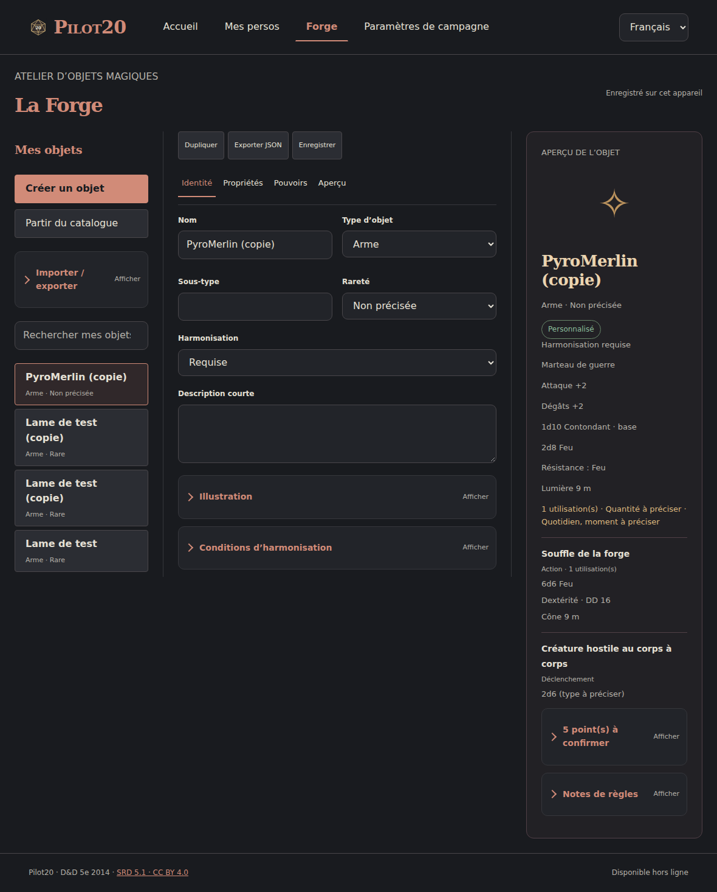
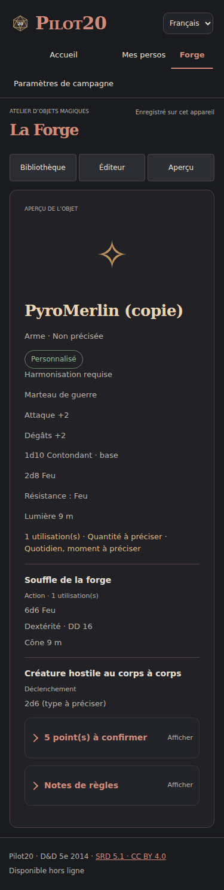

# Forge — atelier d’objets magiques 2014

Branche : `feat/forge-magic-items`. Base examinée : `fd83cc7` (PR #89). Aucun déploiement de production ni fusion.

## Architecture et choix d’intégration

Pilot20 est une application JavaScript native, sans framework, avec modules ESM, rendu DOM, bibliothèque IndexedDB transactionnelle et service worker généré par `scripts/package-web.mjs`. Les personnages, leurs brouillons et le moteur de combat ont déjà leurs propres contrats.

La Forge ajoute une route au menu existant. Son module et son validateur sont chargés à la première ouverture de l’onglet. Le catalogue est chargé à la première recherche, puis réutilisé en mémoire. La saisie ne reconstruit pas le formulaire ; seul l’aperçu est actualisé. Les écritures sont sérialisées et la navigation attend leur fin. Les erreurs de stockage restent affichées ; le bouton Enregistrer permet de réessayer.

Le dépôt `forgeRepository` réutilise l’adaptateur existant et son contrôle transactionnel de révision, sous `meta/forge:item:<id>`. Aucune migration IndexedDB, modification de personnage ou dépendance à Encounter. Les imports sont validés entièrement avant une transaction atomique. Une importation crée des copies et n’écrase aucun original.

## Ergonomie illustrée

Sur iPad : bibliothèque à gauche, quatre sections de travail au centre, fiche d’objet à droite. Les choix détaillés se replient. Les aides ouvrant une fenêtre utilisent ⓘ. Sur iPhone : Bibliothèque / Éditeur / Aperçu, sans colonne comprimée.

L’origine se choisit avec Créer un objet ou Partir du catalogue. L’identité reste courte. Le profil physique dépend de la catégorie. Les propriétés permanentes, configurations, pouvoirs et réserves sont éditables indépendamment. Les illustrations PNG/JPEG/WebP sont importées localement et conservées dans l’export.

## Un seul modèle

Le schéma et les catalogues proviennent de `Pilot20-catalogue-objets-magiques-2014-v1.0.0.zip`, produit le 25 octobre 2026. `magic-item.schema.json` et `magic-items.ts` sont repris sans modification. Aucun deuxième format de définition d’objet n’est introduit.

Le validateur navigateur est généré à partir du schéma JSON 2020-12 par AJV : `npm run build:forge-validator`. Le validateur ne nécessite pas AJV à l’exécution. Le dépôt ajoute des contrôles de références internes et de doublons.

L’enveloppe d’export `{format:"pilot20-forge", version:1, items:[{definition, illustration}]}` contient les définitions originales, sans changer leur structure. Les imports acceptent aussi une définition nue ou un tableau du catalogue. Les illustrations et révisions de stockage ne sont pas des règles D&D.

Le profil physique complémentaire utilise l’extension `p20:effect:custom` déjà prévue par le catalogue, clé `forge:base-profile`, repli manuel. Son payload explicite porte `kind`, `range`, `longRange`, `versatileDice`, `baseAC`, `shieldBase`, `dexCap`, `minimumStrength` et `stealthDisadvantage`. Il ne constitue pas une seconde définition et n’est pas interprété comme un bonus permanent. L’adaptateur de bouclier lit seulement `shieldBase` ; les autres profils attendent leur intégration à la fiche.

Les extensions `forge:temporary-hp`, `forge:teleport`, `forge:aura`, `forge:summon`, `forge:damage-reduction`, `forge:extra-attack` restent manuelles. Leur résumé et leurs paramètres explicites (valeur/dés, distance, nombre) sont exportés, sans interprétation automatique du texte. Les effets spécialisés du catalogue non éditables graphiquement sont conservés sans perte et signalés.

## Contrat avec les futurs modules

`instanceOf(definition, ownerId)` crée un exemplaire séparé de sa définition : version épinglée, quantité, équipement, harmonisation, modes, ressources et révision. Les champs optionnels `active` et `consumed` complètent l’interface ItemInstance préexistante. Les anciens exemplaires sans ces champs restent actifs et non consommés.

- Possédé : propriétaire renseigné et quantité positive.
- Équipé : état `equipped`, séparé de la possession.
- Harmonisé : état `attuned`, avec prérequis et limite de trois par défaut.
- Actif : `active !== false`, pour les effets magiques.
- Consommé : `consumed === true`, sans effet ni équipement utile.

`itemSource(definition, instance, context)` produit des contributions identifiées, des propositions d’actions et des points à résoudre. Les conditions inconnues ne valent jamais vrai. Les conditions d’équipement, harmonisation, caractéristiques, classes, modes, cible, déclencheur et durée sont prises en compte ou mises en attente. Le module n’exécute aucune action dans Encounter.

`resolvePassive(sources, {scores})` déduplique une même contribution, les effets identiques d’une même famille, les résistances et immunités. Les bonus d’arme restent séparés par instance ; ils ne deviennent pas des bonus globaux. Les planchers de caractéristiques respectent les valeurs naturelles supérieures. Les opérations `set`, plafonds et multiplications sont représentées dans le modèle mais mises en attente d’un arbitrage entre toutes les sources du personnage. Il n’existe pas de règle universelle « tous les bonus d’un même type ne se cumulent jamais » : l’intégrateur doit fournir le contexte des aptitudes, dons, sorts et maîtrises.

`shieldAC(definition, instance, baseACWithoutShield, context)` exige une CA sans bouclier ni magie de cet objet. Il ajoute +2 de base (ou le profil physique explicitement fourni), puis le bonus magique une seule fois. Exemple : 18 + 2 + 3 = 23. Il ne reçoit jamais le total déjà calculé sur une fiche PDF.

`validateLoadout` signale dépassement d’harmonisation, prérequis, nombre de mains, emplacements et plusieurs armures/boucliers. Le plafond d’harmonisation est paramétrable pour les exceptions ; aucune exception de classe n’est présumée. Les restrictions fines de chaque classe restent à fournir par le personnage.

`spendResource` et `recoverResource` sont des transactions pures : ils rendent un nouvel état, sans modifier l’ancien. La consommation respecte sa phase (`on-use`, `on-hit`, `on-confirmation`). Le module destinataire doit persister avec contrôle de révision et reçu d’événement pour garantir l’idempotence des appels. Un horaire inconnu ou « quotidien non précisé » interdit la récupération automatique. Le résultat du dé est fourni explicitement ; aucun texte de formule n’est exécuté. Les conséquences de dernière charge doivent être résolues par le module destinataire.

## Automatique, décrit, manuel

| Fonction | État livré |
|---|---|
| Création, édition, copie, bibliothèque, aperçu, illustration | Fonctionnel |
| Sauvegarde continue, rechargement, cache hors ligne | Fonctionnel sur l’appareil après premier chargement réussi |
| Import/export JSON et validation du catalogue | Fonctionnel ; imports toujours en copies |
| Bonus, dégâts, défenses, caractéristiques, soins, sorts, états, déplacements, modes | Édition structurée, sans modification des personnages |
| Activation, déclencheur, coût, ressources, cible, zone, durée, sauvegarde | Édition structurée ; champs avancés repliés |
| Conditions composées préexistantes, effets spécialisés non édités | Conservés ; certaines créations de conditions restent manuelles |
| Bonus passifs additifs, plancher de caractéristique, déduplication, bouclier | Adaptateur pur testé, non connecté au combat |
| Charges et récupération | Transactions pures testées ; aucune horloge ou dépense de personnage activée |
| Téléportation, invocation, aura générique, PV temporaires, réduction, attaque supplémentaire | Paramètres exportés, résolution manuelle explicite |
| Jet, dégâts effectifs, concentration, fin des effets, ciblage interactif | Responsabilité future du Compagnon / Encounter |
| Équipement et harmonisation dans une fiche | Contrat et contrôles livrés ; pas de modification de l’inventaire existant |
| Synchronisation entre appareils | Non incluse ; export/import disponible |

## Vérification des six cas

Lecture des PDF fournis, pages PDF 1 à 3 suivant l’objet. Les captures intégrales des fiches ne sont pas redistribuées. Le catalogue de campagne reste distinct du catalogue officiel.

| Cas | Vérification | Réserve conservée |
|---|---|---|
| Brack / PyroMerlin | Page 1 : 1d10+7 et 2d8 feu ; page 2 : marteau +2, résistance feu, torche 9 m, aura 2d6 au début du tour hostile, souffle action 1/j, cône 9 m, DEX DD16, 6d6/moitié | Type des dégâts d’aura et rayon exact non explicités ; moment de récupération non précisé. Aucun auto-dégât déduit. |
| Kentaro / Kane | Page 1 : épée longue +1, 1d8/1d10, +2d6, polyvalente ; page 2 : mention « lié » | Type des 2d6, activation et sens exact de « lié » non déduits. Les bonus Charisme, maîtrise et aptitudes d’occultiste restent à la charge du personnage. |
| Nans / Volto-Fendoir | Page 1 : épée 1d6/finesse, hache 1d12, bouclier total +2 | Compatibilité épée/bouclier et coût de transformation non explicités. Les modes restent à confirmer ; pas de cumul des trois formes. Le total +8 n’est pas encodé comme bonus magique. |
| Rufus / Hexen Blade | Pages 1–3 : épée courte +1, rare, harmonisation, 5 charges, 1d4+1 à l’aube, DD15, trois coûts 1/2/3 | Les activations restent non renseignées dans le modèle de preuve ; les noms de sorts ne déclenchent pas une résolution implicite. |
| Samoth / Givre confluence | Page 1 : 10 charges, 1d6+4, Mains (1), Vortex (3), « +1 magique » | Cible du +1 et moment de récupération inconnus. La liste de sorts page 3 mentionne Vortex de Glace, mais ne démontre pas à elle seule son rattachement mécanique exact au bâton. |
| Zéphyr / Bouclier +3 | Page 1 : bonus total +5 ; +3 magique séparé du +2 de base | Rarété/harmonisation non attestées par cette fiche. Le calcul ne réutilise pas le total +5 comme bonus magique. |

Le document [COMPAGNIE-CREOLE.md](COMPAGNIE-CREOLE.md) conserve les notes du catalogue amont, notamment les objets supplémentaires de Kentaro.

## Validation

- Suite existante `npm test` : 590 tests passés avant l’ajout de la suite Forge.
- `npm run test:forge` : 14 tests passés. Les 22 catégories, toutes les définitions officielles et de campagne, les six cas, les copies, imports atomiques, révisions concurrentes, erreurs de quota, réouverture IndexedDB, conditions, équipement, phases de charges et non-interprétation du texte sont couverts.
- `npm run test:e2e:forge` : parcours réel Chromium réussi aux dimensions 1180×820, 390×844 et 375×844. Création/édition, charges/pouvoirs, duplication, export/import, catalogue, hors ligne après rechargement, absence de débordement horizontal et retour au créateur sont vérifiés.
- `npm run build:web` réussi. Le service worker inclut les modules et données Forge.
- WebKit/Safari et appareils physiques : non exécutés localement. Le test est ajouté à la matrice Chromium/WebKit de GitHub Actions ; son résultat distant reste à vérifier.

Reproduction : `npm ci`, `npm run build:web`, `npm run dev`, puis ouvrir l’adresse affichée et choisir Forge. Pour un Chromium local alternatif, `PILOT20_CHROMIUM_PATH=/chemin/chromium npm run test:e2e:forge`.

Le dépôt ne propose actuellement qu’un déploiement GitHub Pages sur `main`. Aucun lien de prévisualisation hébergée de cette branche n’est annoncé sans déploiement confirmé.
